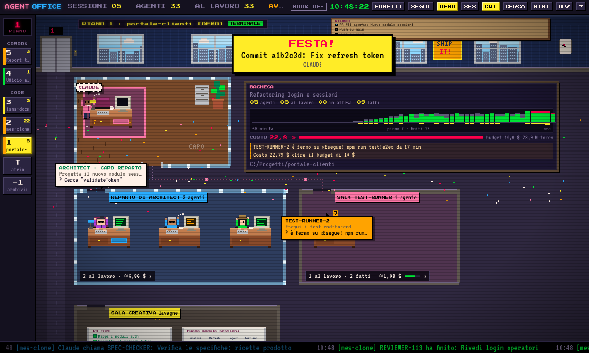
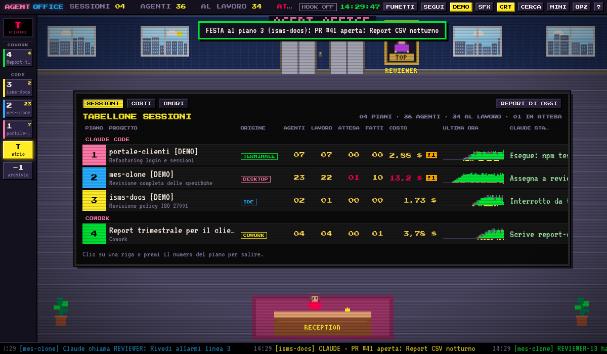
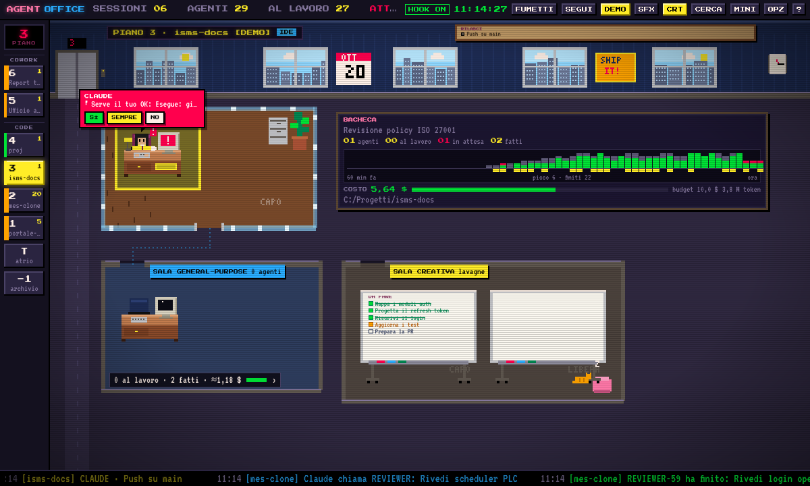
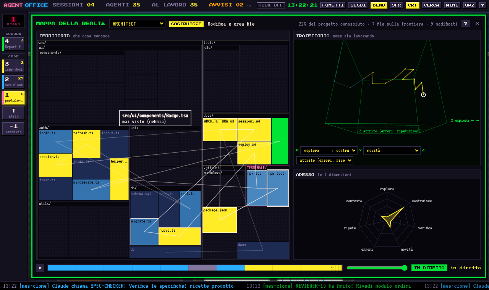
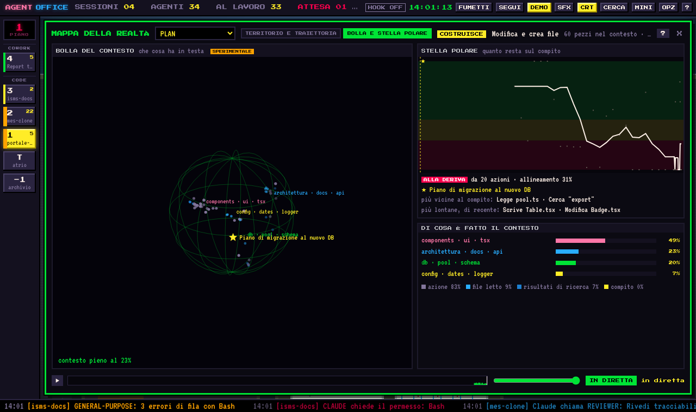

# Platypus

Un palazzo in pixel-art anni '80 dove vedi i tuoi agenti di **Claude Code** al lavoro, in tempo reale.
Gira su **Windows, macOS e Linux**: si clona da git e si lancia, senza installer.

*English version: [README.md](README.md).*



## Che cosa fa

- **Un piano per sessione** di Claude Code, con l'ascensore e un tabellone nell'atrio. Ogni piano è un organigramma: l'ufficio del capo (CLAUDE), le sale dei sottoagenti divise per tipo, i reparti dei capi reparto, i fumetti con quello che stanno facendo.
- **Permessi dal fumetto**: quando un agente chiede un permesso rispondi **SÌ / SEMPRE / NO** direttamente nell'ufficio, oppure nel terminale come sempre.
- **Costi e token** per piano e nel tempo, **avvisi** (agente fermo, errori di fila, budget superato), **archivio e replay** delle sessioni passate, **report giornaliero**.
- **Mappa della realtà** di ogni agente: il territorio che conosce (con la nebbia su ciò che non ha mai visto), la sua traiettoria in uno spazio a 7 dimensioni, la bolla del contesto e la stella polare del compito (sperimentale).
- **Vita d'ufficio**: il gatto sulla tastiera di chi è bloccato, il collega fastidioso (il nome lo scegli tu), le risorse umane che richiamano chi butta giù una lavagna, feste per commit e test verdi, notte, vestiti per feste e meteo, età e mantelli da supereroe secondo modello ed effort.
- **Area relax**: una porta RELAX nell'atrio (o il tasto R) porta alla caffetteria, dove i dipendenti siedono ai tavoli e sui divani, prendono un caffè, e uno mangia una banana (e viene preso in giro); tre cabinati arcade (Pac-Man, Tetris, Space Invaders) si giocano cliccandoli.
- **Italiano e inglese**, con una struttura pronta per altre lingue.

Le novità di ogni versione sono in [CHANGELOG.it.md](CHANGELOG.it.md).

| | |
|---|---|
|  |  |
|  |  |

## Avvio rapido

Serve **[Node.js](https://nodejs.org) 20 o più recente** (e Git per clonare). Tutto il resto lo installa il lanciatore al primo avvio.

```sh
git clone https://github.com/m4xl4b/platypus.git platypus
cd platypus
```

| Sistema | Avvio |
|---|---|
| Windows | doppio clic su **`start.cmd`** (oppure `npm start`) |
| macOS | doppio clic su **`start.command`** (oppure `./start.sh`) |
| Linux | `./start.sh` (oppure `npm start`) |

Il primo avvio scarica Electron (circa 120 MB) e richiede un minuto; i successivi sono immediati.
Per avere l'icona sul Desktop o nel menu delle applicazioni: `npm run shortcut`.

**Senza installare nulla** c'è la modalità browser, che usa solo Node.js: `npm run web` (oppure `node scripts/launch.js --web`).

La guida completa, con i dettagli per ogni sistema e la soluzione ai problemi più comuni, è in [docs/INSTALLAZIONE.md](docs/INSTALLAZIONE.md).

### Aggiornare

```sh
git pull
```

Al lancio successivo le dipendenze si aggiornano da sole, se sono cambiate.

## Collegare Claude Code

L'ufficio legge già i transcript che Claude Code scrive nella cartella `~/.claude`. Per avere gli eventi istantanei e i permessi dal fumetto, collega gli **hook**:

- al primo avvio l'app te lo chiede, oppure
- menu dell'icona nella barra di sistema → *Collega a Claude Code*, oppure
- `npm run hooks:install` (per toglierli: `npm run hooks:uninstall`).

Gli hook vengono aggiunti a `~/.claude/settings.json`. Le tue impostazioni restano intatte e la prima volta viene salvata una copia in `settings.json.platypus-backup`. Valgono per le sessioni aperte dopo l'installazione. Se l'ufficio è chiuso falliscono in silenzio e Claude Code lavora come sempre.

## Privacy

Tutto avviene **sul tuo computer, in sola lettura**: niente cloud, niente chiavi API. Il server dell'ufficio ascolta solo su `127.0.0.1:47800` e rifiuta richieste da altri host o da siti web. L'unica connessione esterna, facoltativa, è il meteo (Open-Meteo, solo il nome della città scelto nelle opzioni; si spegne lasciando vuota la città).

## Comandi principali

| Tasto | Azione |
|---|---|
| `↑` `↓` · `1`…`9` · `T` | cambia piano · vai al piano · atrio |
| `G` | mappa della realtà dell'agente selezionato |
| `A` | archivio e replay |
| `O` | opzioni (lingua, budget, avvisi, personaggi, meteo, cartelle) |
| `/` | cerca su tutti i piani |
| `M` | modalità mini, sempre in primo piano |
| `D` | demo |
| `H` | aiuto e legenda |

## Per chi sviluppa

```sh
npm test            # prove su motore, API, hook e traduzioni (non serve installare nulla)
npm run i18n:check  # testi da tradurre
npm run start:demo  # finestra con la demo
```

- Il **motore** (`src/core`) è Node.js puro, senza dipendenze: legge i dati, tiene lo stato e serve l'interfaccia e le API su HTTP.
- L'**interfaccia** (`renderer/`) è una pagina web statica: la stessa nella finestra desktop e nel browser.
- La **finestra** (`src/main.js`) è un guscio Electron sottile; i dettagli, e come sostituirlo con Tauri, sono in [docs/ARCHITETTURA.md](docs/ARCHITETTURA.md).
- Per contribuire: [CONTRIBUTING.it.md](CONTRIBUTING.it.md).

Volendo, si possono anche compilare i programmi per ogni sistema (`npm run dist:win`, `dist:mac`, `dist:linux`), ma non è il modo previsto di distribuirlo.

## Licenza

[MIT](LICENSE) © 2026 Massimiliano Pane.
Font: Press Start 2P e VT323 (SIL Open Font License, inclusi in `renderer/fonts`).
