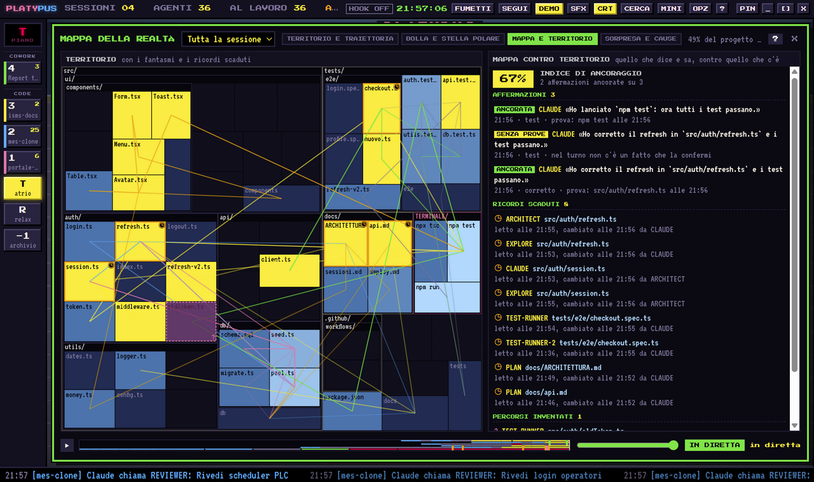
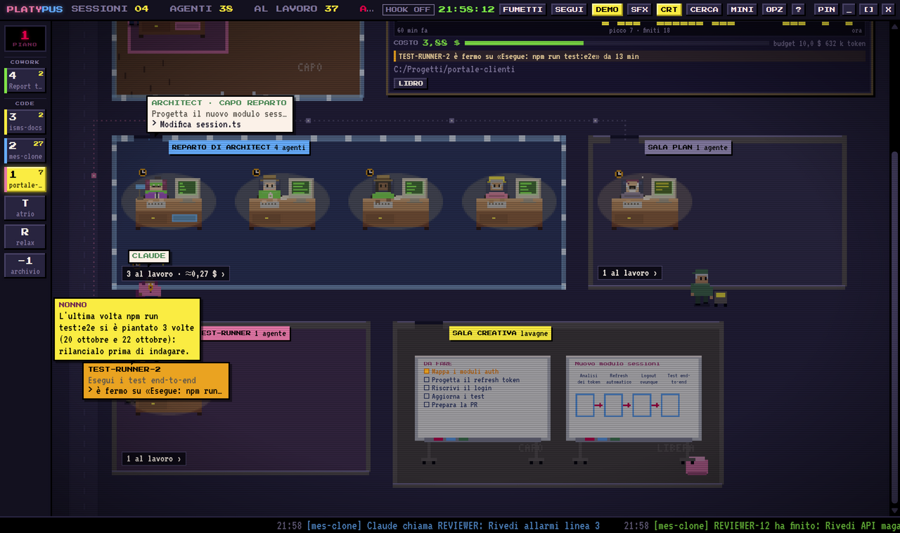

# Platypus

An 80s pixel-art office building where you watch your **Claude Code** agents at work, in real time.
Runs on **Windows, macOS and Linux**: clone it with git and launch it, no installer needed.

*Versione italiana: [README.it.md](README.it.md).*


## What it does

- **One floor per Claude Code session**, with an elevator and a board in the lobby. Each floor is an org chart: the boss's office (CLAUDE), the subagent rooms grouped by type, the department heads' departments, and speech balloons showing what everyone is doing.
- **Permissions from the balloon**: when an agent asks for permission, answer **YES / ALWAYS / NO** right in the office, or in the terminal as usual.
- **Costs and tokens** per floor and over time, **alerts** (stuck agent, repeated errors, budget exceeded), **archive and replay** of past sessions, **daily report**.
- **Map of reality** for each agent: the territory it knows (with fog over what it has never seen), its trajectory through a 7-dimensional space, the context bubble and the task's north star (experimental).
- **Map versus territory**: files an agent read that have changed since (stale memories), paths it looked for or mentioned that don't exist (invented paths), and its claims ("tests pass", "I fixed X") checked against what it actually did in the same turn, with a grounding index. In the office: a clock next to the head, a dashed balloon with "no evidence".
- **Surprise and causes**: a seismograph of the failures, as tall as they were unexpected; whether the agent corrects itself, insists or stops; whether its first edits touch the files the error points to, up to the test that turns green again. In the office: a "!?" above the head and a grey cloud for whoever insists.
- **Workshop book and Grandpa**: the memory of each project, deduced from its sessions (flaky commands, fragile files, known fixes, traps…). Grandpa walks to the desk of an agent about to repeat a known mistake and tells the lesson; the Book can propose a section for the project's `CLAUDE.md`, written only after you confirm.
- **Office life**: the cat on the keyboard of whoever is stuck, the annoying coworker (you pick the name), HR scolding whoever knocks over a whiteboard, parties for commits and green tests, night time, outfits for holidays and weather, age and superhero capes based on model and effort.
- **Relax area**: a RELAX door in the atrium (or the R key) leads to the cafeteria, where employees sit at the tables and on the sofas, grab a coffee, and one eats a banana (and gets teased for it); hovering an employee shows their plausible yet absurd job title; four arcade cabinets (Pac-Man, Tetris, Space Invaders, Frogger) are playable by clicking on them.
- **Italian and English**, with a structure ready for more languages.

What's new in each version is in [CHANGELOG.md](CHANGELOG.md).

| | |
|---|---|
|  |  |
|  |  |
|  |  |

## Quick start

You need **[Node.js](https://nodejs.org) 22.12 or newer** (and Git to clone). The launcher installs everything else on first run.

```sh
git clone https://github.com/m4xl4b/platypus.git platypus
cd platypus
```

| System | Launch |
|---|---|
| Windows | double-click **`start.cmd`** (or `npm start`) |
| macOS | double-click **`start.command`** (or `./start.sh`) |
| Linux | `./start.sh` (or `npm start`) |

The first launch downloads Electron (about 120 MB) and takes a minute; later launches are instant.
To get an icon on the Desktop or in the applications menu: `npm run shortcut`.

**Without installing anything** there is browser mode, which only needs Node.js: `npm run web` (or `node scripts/launch.js --web`).

The full guide, with details for each system and fixes for the most common problems, is in [docs/INSTALL.md](docs/INSTALL.md).

### Updating

```sh
git pull
```

On the next launch the dependencies update themselves, if they have changed.

## Connecting Claude Code

The office already reads the transcripts Claude Code writes to the `~/.claude` folder. For instant events and permissions from the balloon, connect the **hooks**:

- the app asks you on first launch, or
- system tray icon menu → *Connect to Claude Code*, or
- `npm run hooks:install` (to remove them: `npm run hooks:uninstall`).

The hooks are added to `~/.claude/settings.json`. Your settings stay intact, and the first time a copy is saved to `settings.json.platypus-backup`. They apply to sessions opened after installing. If the office is closed they fail silently and Claude Code works as usual.

## Privacy

Everything happens **on your computer, read-only**: no cloud, no API keys. The office server only listens on `127.0.0.1:47800` and rejects requests from other hosts or from websites. The only outside connection, optional, is the weather (Open-Meteo, only the city name chosen in the options; turn it off by leaving the city empty).

## Main controls

| Key | Action |
|---|---|
| `↑` `↓` · `1`…`9` · `T` | change floor · go to floor · lobby |
| `G` | map of reality for the selected agent |
| `A` | archive and replay |
| `O` | options (language, budget, alerts, characters, weather, folders) |
| `/` | search all floors |
| `M` | mini mode, always on top |
| `D` | demo |
| `H` | help and legend |

## For developers

```sh
npm test            # checks on engine, API, hooks and translations (nothing to install)
npm run i18n:check  # strings to translate
npm run start:demo  # window with the demo
```

- The **engine** (`src/core`) is pure Node.js, with no dependencies: it reads the data, keeps the state and serves the interface and the API over HTTP.
- The **interface** (`renderer/`) is a static web page: the same in the desktop window and in the browser.
- The **window** (`src/main.js`) is a thin Electron shell; the details, and how to replace it with Tauri, are in [docs/ARCHITECTURE.md](docs/ARCHITECTURE.md).
- To contribute: [CONTRIBUTING.md](CONTRIBUTING.md).

If you want, you can also build binaries for each system (`npm run dist:win`, `dist:mac`, `dist:linux`), but that is not the intended way to distribute it.

## License

[MIT](LICENSE) © 2026 Massimiliano Pane.
Fonts: Press Start 2P and VT323 (SIL Open Font License, included in `renderer/fonts`).
